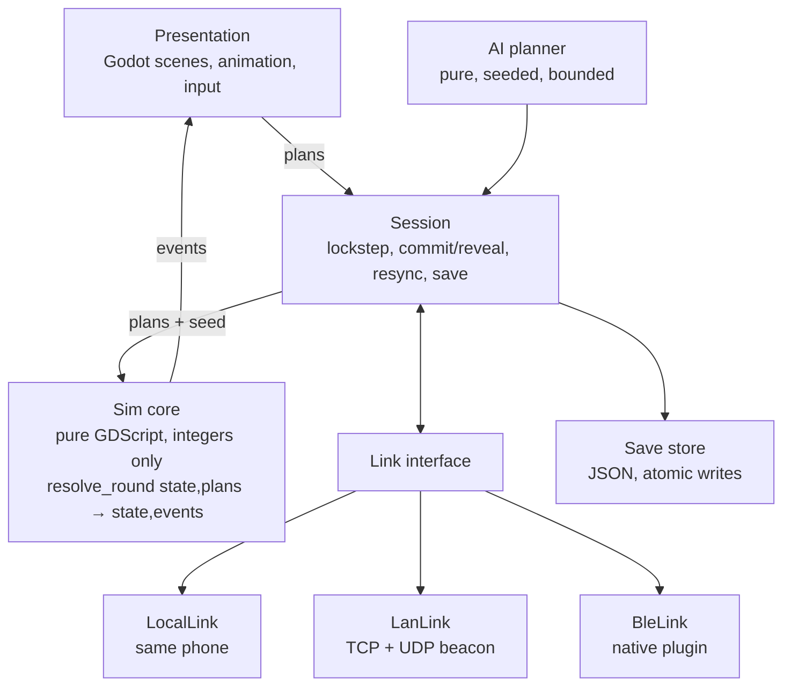

# Technical Design Notes

> Part of the [Game Design Document](../GAME_DESIGN.md). These notes are about feasibility, not a full architecture spec. Per `AGENTS.md`, `docs/architecture.md` and ADRs come after this design is approved. Claims marked **(verify)** are assumptions to confirm in the first spikes.

---

## 1. Architecture overview



- **The Sim core has no Godot node dependencies.** It has plain classes and one entry point: `resolve_round(state, plans) -> {state, events}`. It runs headless in tests and in CI.
- **Events** (e.g. `Bounced{unit, tile, reason}`) drive animation and the "Why?" log. The UI never computes game logic.
- **The AI is a pure function:** `plan(state, ai_rng) -> plans`.

## 2. Stack

| Item | Choice | Note |
|---|---|---|
| Engine | **Godot 4** (latest stable at kickoff, pinned for the life of a major version) | Upgrades only happen at minor releases, after the determinism suite passes on devices. |
| Language | **GDScript** | It's fast enough for a 6×6 board. C#/.NET export to mobile adds risk **(verify the current state)**. If AI search ever needs it, the AI moves to GDExtension (C++) later. |
| Tests | GUT or gdUnit4, run with headless Godot in CI | |
| QR generate | Pure-GDScript encoder (small, existing open-source options) | |
| QR scan | Native plugin: iOS AVFoundation, Android CameraX + an on-device barcode lib (ZXing or bundled ML Kit, which works offline **(verify)**) | |
| BLE | Native plugins: iOS CoreBluetooth (peripheral + central), Android BLE GATT | The largest native-code item. Not in v0.1; ships before v1.0. |

## 3. Determinism requirements

Both phones (and every save resume) must produce **bit-identical** results.

| Rule | Why |
|---|---|
| **Integers only in Sim and AI.** No `float`, no `Vector2`, no engine math. Stats are small ints, and any fraction uses ×100 fixed-point ints. | Float behaviour can differ across CPUs, compilers, and engine versions. |
| **Avoid `/` and `%` on negative numbers** (use helpers). | Keeps semantics explicit. |
| **No wall-clock, no frame time, no OS randomness** in Sim or AI. | Inputs fully determine outputs. |
| **Canonical ordering:** units are stored in arrays sorted by `unit_id`. Never iterate a Dictionary whose insertion order came from non-deterministic code. | Godot Dictionaries keep insertion order, but we don't rely on how they were built. |
| **Rules are order-independent by design** ([core-rules.md](core-rules.md#1-design-goals-for-the-rules)), and a test shuffles unit order to prove it. | It catches hidden order dependence. |
| **Ruleset data is versioned:** unit stats, abilities, and maps are data files with a `ruleset_id` and content hash. The hash is exchanged in `HELLO`. | Both phones must run identical rules. |
| **Old rulesets ship with new builds** (same major version). | Two offline phones on different app versions can still play, using the older ruleset (F5). |
| **Bounded AI:** fixed iteration counts, never "think for 50 ms". | Time budgets differ per device and would desync co-op. |

## 4. RNG

- **Our own RNG, not Godot's `RandomNumberGenerator`**, so engine updates can't change sequences.
- Algorithm: **xoshiro128\*\*** on 32-bit state words, kept in 64-bit GDScript ints and masked with `& 0xFFFFFFFF`. Its multipliers are only ×5 and ×9, so products stay far below 2^63 and nothing overflows.
- Seed derivation uses a 32-bit mix hash with a **`mul32(a, b)` helper** that multiplies in 16-bit halves. A raw 32×32 multiply can overflow signed int64, which is a real bug class to unit-test.
- **Separate streams**, each seeded from `hash(run_seed, stream_name)`:
  - `map` (Tide Chart and enemy compositions)
  - `reward` (offers and Market stock)
  - `ai` (tie-breaks only)
  - `keepsake` (names, morphs, Quirks)
  - `cosmetic` (**not synced**, used for UI flair, never read by the Sim)
- Combat resolution uses **no RNG at all.**
- **Golden test vectors:** the first 1,000 outputs of each stream for 5 seeds, checked into tests.

## 5. AI determinism

- The AI runs at the **start of the planning step**, from the state alone, before any player input exists. Its plan is stored in the round record. In debug builds, a hash of the AI plan is logged before the player locks, to prove it never saw the player's plan.
- In **co-op**, both phones compute the AI plan independently and include it in `STATE_HASH`. A divergence is caught on the round it happens.

## 6. Netcode messages

The wire format uses binary frames: `[u8 type][u16 length][payload]`, hand-packed with `StreamPeerBuffer`. We don't use `var_to_bytes`, so the format is under our control and stable across engine versions.

| Type | Direction | Payload | When |
|---|---|---|---|
| `HELLO` | both | proto_ver, app_ver, ruleset ids + hashes[], profile name, avatar, nonce | Right after connecting |
| `HELLO_ACK` | both | chosen ruleset, session_id, `HMAC(pairing_key, nonces)` | Authenticates a QR or word-code join |
| `JOIN_REQUEST` / `JOIN_DECISION` | guest → host / host → guest | name / accept or deny | Nearby-list joins (no key) |
| `LOBBY` | host → guest | mode, options, host unlock set, match seed | Lobby changes |
| `READY` | both | mode | |
| `DRAFT_PICK` | both | critter id / shell ids | Versus draft |
| `PLAN_COMMIT` | both | round, sha256(plan ‖ salt) | Versus lock |
| `PLAN_REVEAL` | both | round, plan bytes, salt | After holding the peer's commit |
| `PLAN_LOCK` | both | round, plan bytes | Co-op lock (no commit needed) |
| `PLAN_DRAFT` | both | round, partial plan | Co-op live ghosts, ≤4/s |
| `PING_TILE` | both | tile, kind | Co-op pings |
| `VOTE` | both | stop choice | Co-op map |
| `STATE_HASH` | both | round, sha256(canonical state) | After each resolution |
| `RESYNC_REQ` / `SNAPSHOT` | guest → host / host → guest | round / chunked state (~4 KB) | On a hash mismatch |
| `PAUSE` / `RESUME` | both | reason | App backgrounded, menu |
| `TRADE_OFFER` / `TRADE_ACCEPT` / `TRADE_READY` / `TRADE_DONE` | both | see [two-player.md §6.4](two-player.md#64-preventing-duplication-offline) | Trading |
| `JOURNAL_SYNC` | both | pending trade ids + states | On every link, to finish stuck trades |
| `KEEPALIVE` | both | seq | Every 1 s (LAN) / 3 s (BLE) |
| `BYE` | both | reason | Clean exit |

**Plan encoding:** per unit, it's `unit_id u8 | path len u2 + 3×dir u2 | action u2 | aim u6 (tile or dir)`. That's about 3 bytes per unit, or under 20 bytes per round, so **BLE is comfortably fast enough**.

**Session layer:** every message has a `seq`, and the receiver acks. On reconnect, both sides exchange `last_seq_received` and resend from there. This makes reconnect transport-independent.

## 7. Transport layer abstraction

```gdscript
# Link: the only thing the Session knows about. One instance per connection.
class_name Link
signal connected(peer_info)
signal message(bytes: PackedByteArray)
signal disconnected(reason: String)
func listen(options: Dictionary) -> void   # host side; may also advertise
func connect_to(address: Dictionary) -> void
func send(bytes: PackedByteArray) -> void   # reliable, ordered, framed by the Link
func poll() -> void                         # called each frame
func close() -> void
func quality() -> int                       # 0..3 bars for the lobby
```

| Implementation | How |
|---|---|
| `LocalLink` | An in-memory pair of queues. It's used for same-phone versus, and **for tests: two Sessions wired back-to-back simulate a full Link match headless.** |
| `LanLink` | `TCPServer` + `StreamPeerTCP` for the session (reliable and ordered for free). Discovery uses `PacketPeerUDP` broadcast beacons every 1 s, carrying `{name, port, proto}`. |
| `BleLink` | A native plugin exposing write-with-response (guest → host) and notify (host → guest) characteristics, MTU negotiation, chunking, and acks. |

**Platform notes (verify in Spike P1):**
- **iOS Local Network privacy:** `NSLocalNetworkUsageDescription` is required, and the system prompt appears on first LAN use.
- **UDP broadcast/multicast on iOS** requires the `com.apple.developer.networking.multicast` entitlement, which needs an Apple request. **If it's not granted,** the Nearby list works only when Android is the one broadcasting, and QR (unicast TCP) still works everywhere. The QR is the primary path for exactly this reason.
- **Android hotspot:** `LocalOnlyHotspot` (Android 8+) gives an app-created network with credentials we can show as a Wi-Fi QR. Location or Nearby-devices permission and OEM quirks apply. iOS apps can't create hotspots.
- **Wi-Fi without internet:** phones may warn, or auto-switch to mobile data. Sockets bound to the Wi-Fi interface keep working on LAN.
- **Client isolation** on school and café Wi-Fi blocks phones from seeing each other. We detect this (F2) and recommend a hotspot.
- **Avoided:** Apple Multipeer Connectivity (iOS-only), Google Nearby Connections (Android-only in practice).

## 8. Save format

**Files** (in the app's user data dir, all JSON, UTF-8):

| File | Contents |
|---|---|
| `profile.json` | schema, profile_id, device_id, display name, avatar, settings, unlock flags, Tide Marks, journal feats, stats |
| `aquarium.json` | Keepsakes (with provenance), tombstones, trade journal |
| `run_solo.json` / `run_daily.json` / `run_coop_<partner>.json` / `match_<id>.json` | Active games, one slot each |

**Run save = snapshot + input log** (a replay, not a dump):

```json
{
  "schema": 1,
  "ruleset": "1.2",
  "mode": "solo",
  "seed": "9f3c1a77e0b2d401",
  "rng": { "map": [1,2,3,4], "reward": [..], "ai": [..], "keepsake": [..] },
  "stop": 4,
  "snapshot": { "...state at the start of this stop...": "" },
  "rounds": [ { "r": 1, "plans": "base64" }, { "r": 2, "plans": "base64" } ],
  "draft_plan": { "r": 3, "plans": "base64" },
  "ui": { "screen": "battle_plan", "selected_unit": 2 }
}
```

- **Save anywhere:** a write happens on every committed input, every plan edit (debounced to 1 s), and on app backgrounding. Resume rebuilds by loading the snapshot and replaying the rounds. This takes milliseconds, and **every resume doubles as a determinism check**.
- **Atomic writes:** write `*.tmp`, fsync, then rename. Keep **2 rotating backups**. If the main file is corrupt, load a backup and tell the player plainly. Never wipe.
- **Migrations:** `schema` ints with forward-only migration functions, tested against fixtures from every released version.
- **Backups:** OS device backups (iCloud device backup / Android Auto Backup) include these files. Post-launch, **Move to new phone** will transfer the profile over Link Up, *moving* it (the source is cleared after confirmation).

## 9. Purchases

None. The game is completely free, so there's no store purchase code, entitlement, or receipt handling.

## 10. Testing strategy

| Layer | Tests |
|---|---|
| Sim rules | One test per rule and per row of the [edge-case table](core-rules.md#9-edge-case-table-for-tests-and-the-why-log). The worked examples are golden tests. |
| Order independence | Property test: 10k random states × shuffled unit order give an identical result. |
| Determinism | 10k seeded full battles, with the state hash per round compared against stored goldens, **on real iOS and Android devices** (a device test build runs the suite and prints one final hash). |
| RNG | Golden vectors and `mul32` overflow tests. |
| Session | Two `LocalLink` Sessions back-to-back, with injected drops, duplicates, reorders, and disconnects. Checks resync and trade crash recovery at every step. |
| Saves | Kill the process at random points during writes and verify recovery. Migration fixtures. |
| Pairing | A manual protocol with real device pairs (see [GAME_DESIGN.md §11.3](../GAME_DESIGN.md#113-riskiest-assumptions-and-how-to-test-them-first)). |

## 11. Technical risks

| Risk | Likelihood | Impact | Mitigation |
|---|---|---|---|
| Non-technical players can't pair | Medium | **High** | QR-first, Nearby list, hotspot helper, one-phone fallback. Spike P1 before anything else. |
| iOS multicast entitlement denied or delayed | Medium | Medium | QR (unicast) is the primary path. Nearby list as a bonus. |
| School/café Wi-Fi client isolation | High | Medium | Detect it and steer to a hotspot. |
| BLE native plugin effort and flakiness on both OSes | High | Medium | It's the last transport, built after LAN is solid, with a spike early in Phase 2 to leave time to iterate. Inputs are tiny. |
| Determinism breaks after an engine upgrade | Low | High | Integer-only sim, own RNG, device golden suite as an upgrade gate. |
| Godot mobile quirks (startup, size, OS updates) | Medium | Medium | Pin the version, keep a small device lab (2 old + 2 new per OS), test OS betas each summer. |
| QR scanning plugin quality | Low | Medium | Word-code fallback. Nearby list. |
| Save corruption | Low | High | Atomic writes, backups, replay-based saves. |
